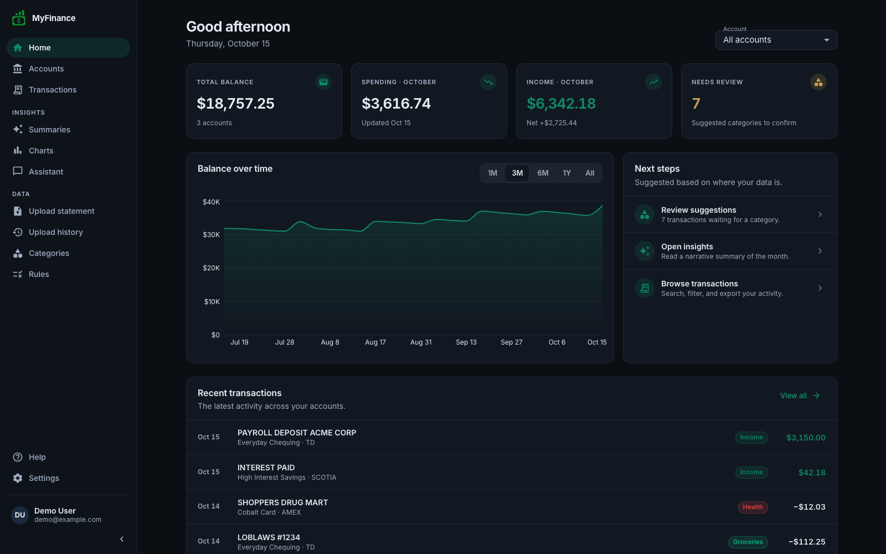
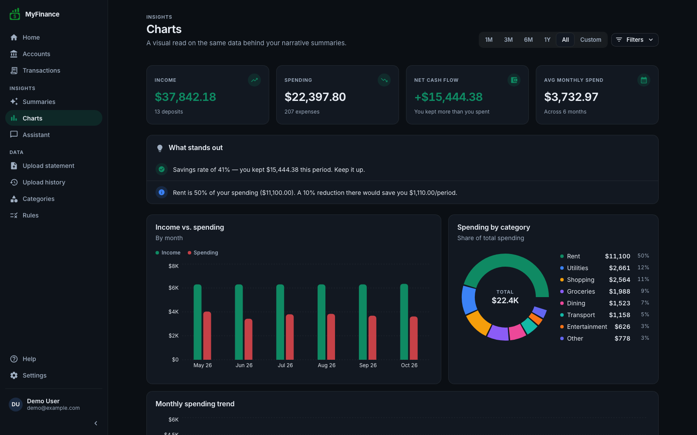
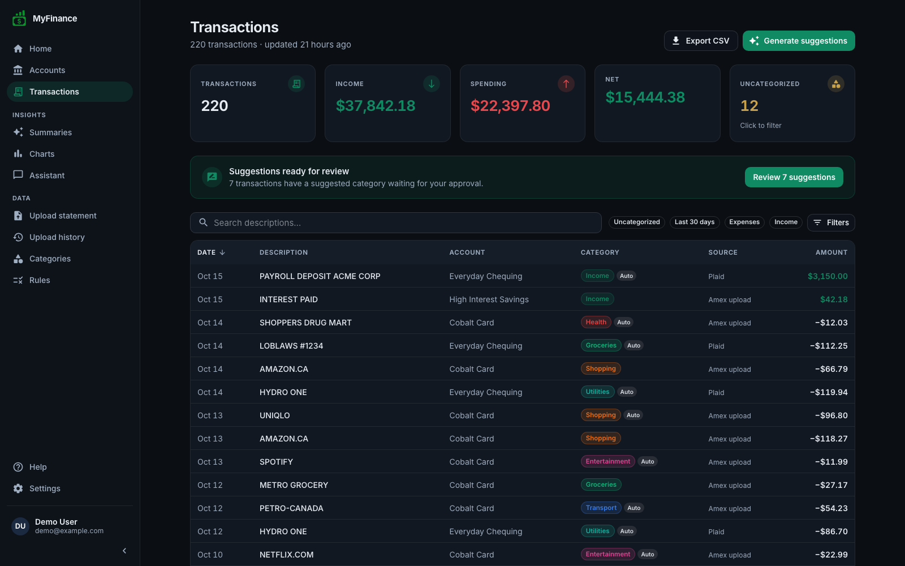

# MyFinance Dashboard

A personal finance dashboard. I upload bank statements or connect accounts through Plaid, the app categorizes the transactions, and I get balances, spending charts, and monthly summaries in one place.

Stack: Next.js 15, React 19, TypeScript, Supabase (Postgres, Auth, Storage, RLS), Material UI 6, and a small TypeScript worker for background jobs.



| Charts | Transactions |
|---|---|
|  |  |

The screenshots use generated sample data.

The older Django + Create React App version is archived in `legacy/` for reference. All active work happens in `web/` and `worker/`.

---

## What it does

- Parses Amex XLSX statements on upload and skips duplicate transactions using a per-transaction fingerprint.
- Imports transactions from linked bank accounts through Plaid.
- Categorizes transactions with user-defined rules, then suggests categories for the rest. Suggestions wait in a review queue, and accepting or correcting one feeds back into future suggestions.
- Lets you undo an upload, which removes every transaction it added.
- Shows a home dashboard with total balance, monthly spending and income, balance over time, and recent activity.
- Has a charts page for income vs. spending by month, spending by category, and monthly trends.
- Writes plain-language monthly summaries and answers questions about your spending in a chat view. These use the Anthropic API with a key each user saves in Settings.
- Keeps each user's data separate with Supabase row-level security. Sign-in supports email/password, Google, and GitHub.
- Supports light, dark, and system themes.

---

## Repo structure

```
web/          Next.js app (pages + API route handlers)
worker/       TypeScript polling worker (parses uploads, applies rules, generates summaries)
supabase/     SQL migrations
docs/         Architecture notes, migration plan, screenshots
legacy/       Archived Django + CRA version (do not modify)
```

---

## Prerequisites

- Node.js 18+
- A [Supabase](https://supabase.com) project (the free tier works)
- Plaid API credentials, only if you want bank connections
- An Anthropic API key, only if you want AI suggestions, summaries, and chat (entered per user in Settings)

---

## Setup

### 1. Database

Apply the migrations in `supabase/migrations/` to your Supabase project with the CLI or the dashboard SQL editor:

```bash
supabase db push
```

### 2. Web app (`web/`)

```bash
cd web
cp env.example .env.local   # fill in your Supabase and Plaid values
npm install
npm run dev                  # http://localhost:3000
```

Env vars in `web/.env.local`:

| Variable | Description |
|---|---|
| `NEXT_PUBLIC_SUPABASE_URL` | Supabase project URL |
| `NEXT_PUBLIC_SUPABASE_ANON_KEY` | Supabase anon key |
| `SUPABASE_SERVICE_ROLE_KEY` | Supabase service role key (server-side only) |
| `PLAID_CLIENT_ID` | Plaid client ID (optional) |
| `PLAID_SECRET` | Plaid secret (optional) |
| `PLAID_ENV` | `sandbox`, `development`, or `production` |
| `E2E_EMAIL`, `E2E_PASSWORD` | Test user for the Playwright suite (local only) |

### 3. Worker (`worker/`)

The worker polls Supabase for pending jobs and claims them with an atomic `dequeue` RPC.

```bash
cd worker
npm install
npm run dev                  # tsx watch mode
```

Env vars for the worker:

| Variable | Description |
|---|---|
| `SUPABASE_URL` | Supabase project URL |
| `SUPABASE_SERVICE_ROLE_KEY` | Supabase service role key |
| `WORKER_ID` | Worker identifier, e.g. `worker-local-1` (defaults to one based on the process ID) |
| `POLL_INTERVAL_MS` | Polling interval in ms (defaults to `1000`) |

### 4. Auth

In your Supabase project's Auth settings:

- Enable the Email provider for email/password sign-in.
- Set the Site URL to `http://localhost:3000` for local development.
- Enable Google and GitHub OAuth if you want them.

---

## Dev commands

```bash
# From the repo root
npm run web:dev        # Next.js app on port 3000
npm run worker:dev     # Worker with auto-reload

# From web/
npm run build          # Production build
npm run lint
npm run test:e2e       # Playwright E2E tests
npm run test:e2e:ui    # Playwright UI mode

# From worker/
npm run build          # Compile to dist/
npm run start          # Run the compiled worker
```

---

## API routes

| Route | Purpose |
|---|---|
| `POST /api/ingest/amex` | Upload and parse an Amex XLSX statement |
| `POST /api/plaid/link-token` | Create a Plaid Link token |
| `POST /api/plaid/import` | Import transactions from Plaid |
| `POST /api/auto-categorization/apply` | Apply categorization rules in bulk |
| `POST /api/auto-categorization/apply-suggestion` | Accept one suggested category |
| `POST /api/uploads/[uploadId]/undo` | Undo an upload |
| `GET /api/insights` | List monthly summaries |
| `POST /api/insights/generate` | Queue a new summary |
| `POST /api/chat` | Ask a question about your transactions |
| `/api/user-settings/anthropic-key` | Save or check the user's Anthropic key |
